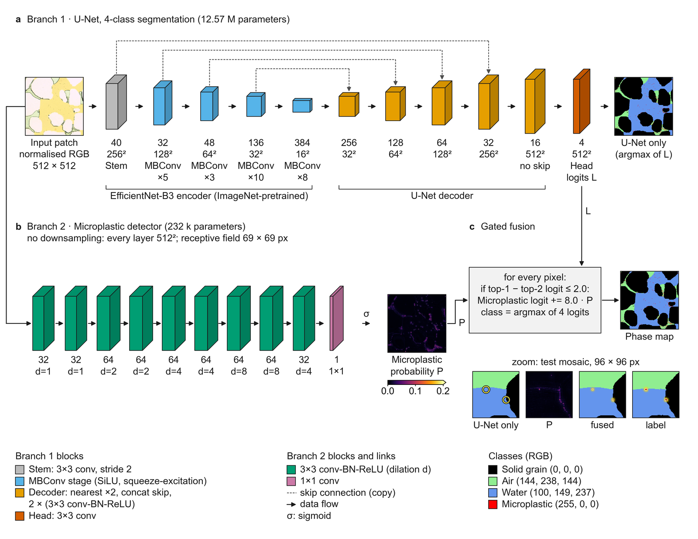

# ParticleVision Segmenter

ParticleVision colours every pixel of a lab micrograph as **solid grain, air, water or microplastic** and
measures how much of each there is, for a whole lab folder at once.

[](https://doi.org/10.5281/zenodo.23691786)
[](LICENSE)
[](https://www.python.org/downloads/release/python-31210/)

Paper in preparation for *Scientific Data*.

**Contents:** [Overview](#overview) · [What you need](#what-you-need) ·
[Download the model files](#download-the-model-files) · [Quick start](#quick-start) ·
[Segment your images](#segment-your-images) · [Hollow-particle filling](#hollow-particle-filling-automatic) ·
[Fix Segmentations](#fix-segmentations-folders-segmented-with-an-older-version) · [Command line](#command-line-optional) ·
[Faster mode on Windows](#faster-mode-on-windows-without-nvidia-optional) · [Troubleshooting](#troubleshooting) ·
[Training](#training) · [Test images](#test-images) · [Limitations](#limitations) · [Licence](#licence) ·
[How to cite](#how-to-cite) · [Acknowledgements](#acknowledgements) · [Contact](#contact)

---

## Overview



*(a) A U-Net with an EfficientNet-B3 encoder maps each 512 × 512 patch to logits for four classes; (b) a microplastic detector maps the same patch to a microplastic probability P.*<br>
*(c) Wherever the gap between the two largest U-Net logits is ≤ 2.0, 8.0 · P is added to the microplastic logit; the largest logit gives the phase map.*

**Version 1.1.0** — new: hollow (ring-shaped) microplastic particles are filled automatically
([Hollow-particle filling](#hollow-particle-filling-automatic)).

---

## What you need

| | |
|---|---|
| Computer | **Mac** with Apple Silicon (M1, M2, M3, M4 …), or **Windows 10 / 11, 64-bit (x64)**. An Intel Mac also works, but is slower. |
| Python | **Python 3.12.10** from python.org: <https://www.python.org/downloads/release/python-31210/>. On Windows, tick **"Add python.exe to PATH"** on the installer's first screen. |
| Disk space | About **1.5 GB** on a Mac for ParticleVision and its packages; on Windows with an NVIDIA card plan for up to **5 GB** (the CUDA packages are large). Plus about **44 MB per segmented image**. |
| Internet | For the first setup only (it downloads 1–3 GB). After that, ParticleVision runs offline. |
| Graphics card | Optional. An **NVIDIA** card is used automatically (about 10 s per image). An Apple Silicon Mac uses its built-in graphics (about 10 s per image). Without a graphics card it runs on the processor (1–3 min per image). Windows with AMD / Intel graphics: optional [faster mode](#faster-mode-on-windows-without-nvidia-optional). |

---

## Download the model files

The **lab package** already contains them. A copy of this **repository** does not (they are larger than GitHub
allows): they are on Zenodo, **<https://doi.org/10.5281/zenodo.23691786>**.

| File | Size | MD5 | Goes in | |
|---|---|---|---|---|
| `stage3_unet_corrected_best.pth` (U-Net) | 154,051,847 bytes (147 MB) | `ade212f6d13f393cb2a27792eb4797b6` | `checkpoints/corrected_v1/` | required |
| `fines_detector_corrected_best.pth` (microplastic detector) | 951,887 bytes (0.9 MB) | `6338e290cfdb999e509cf7f04587bbcd` | `checkpoints/corrected_v1/` | required |
| `unet_fp32.onnx` | 50,304,436 bytes (48 MB) | `1b412c00373613cea25ed2f98706db4f` | `accel/` | optional (Windows faster mode only) |
| `fines_fp32.onnx` | 930,523 bytes (0.9 MB) | `7f67f77e7dadf82f1d1fe7ef42132680` | `accel/` | optional (Windows faster mode only) |

Run the commands below in a terminal inside the ParticleVision folder (on a Mac, type `python3` instead of
`python`). They need only Python, no other packages, so they work before the setup. Each file is put in its folder
only if its MD5 checksum matches; leave out `--with-accel` to skip the two optional ONNX files.

**Option A — download the files yourself** from the Zenodo record into one folder, then:

```bash
python tools/download_models.py --from-dir <folder> --with-accel
```

**Option B — let the helper download them:**

```bash
python tools/download_models.py --base-url https://zenodo.org/records/23691786/files --with-accel
```

If option B reports `CERTIFICATE_VERIFY_FAILED` on a Mac, double-click **Install Certificates.command** in
Applications → Python 3.12 once and run it again, or use option A.

Without the model files, `check_install.py` and the app stop with a message that says which file is missing,
where to download it and where to put it.

The trained model weights are under the same MIT licence as the code ([LICENSE](LICENSE)).

---

## Quick start

### Mac

1. Put the **ParticleVision** folder in your home folder (Finder → **Go → Home**), not in an iCloud-synced
   Desktop or Documents folder.
2. Double-click **`setup_mac.command`** (the first time: right-click → **Open** → **Open**). It takes about
   15–30 minutes. Success ends with:
   ```text
     SELF-TEST PASSED
   ======================================================================
     SUCCESS — ParticleVision is installed and the self-test passed.
   ======================================================================
   ```
3. To check the installation again at any time, in Terminal inside the ParticleVision folder:
   ```bash
   .pv_env/bin/python check_install.py
   ```
   It must end with **SELF-TEST PASSED**, after these `[PASS]` lines:
   ```text
     [PASS] model file stage3_unet_corrected_best.pth is the confirmed version (MD5 ade212f6…)
     [PASS] model file fines_detector_corrected_best.pth is the confirmed version (MD5 6338e290…)
     [PASS] scipy 1.13.1 installed (needed by the post-processing, src/postprocess.py)
     [PASS] D05 image (closing): 65 px filled — identical to the Mac result
     [PASS] D10 image (circles): 425 px filled, 29 circles — identical to the Mac result
   ```
4. Double-click **`run_app.command`**. Your browser opens ParticleVision (the Terminal window shows the address,
   e.g. `http://localhost:8501`). Keep the Terminal window open while you use the app.

### Windows

1. Extract the zip to **`C:\`** so that you have **`C:\ParticleVision`**. Keep it short — not on the Desktop,
   not in Downloads, not in OneDrive.
2. Double-click **`setup_windows.bat`** (if "Windows protected your PC" appears: **More info → Run anyway**).
   It takes about 20–40 minutes. Success ends with:
   ```text
     SELF-TEST PASSED
   ======================================================================
     SUCCESS — ParticleVision is installed and the self-test passed.
   ======================================================================
   ```
3. To check the installation again at any time, in Command Prompt:
   ```bat
   cd C:\ParticleVision
   .pv_env\Scripts\python check_install.py
   ```
   It must end with **SELF-TEST PASSED**, after the same `[PASS]` lines as on the Mac (step 3 above), plus
   `[PASS] Tcl/Tk available (needed by the folder picker)`.
4. Double-click **`run_app.bat`**. Your browser opens ParticleVision (the black window shows the address,
   e.g. `http://localhost:8501`). Keep the black window open while you use the app.

**Updating from an earlier version?** Put the new folder **next to** the old one (don't copy it over), and run
the setup once in the new folder. Windows faster mode: double-click **`setup_accel_windows.bat`** again afterwards.

Step-by-step details: [docs/INSTALL_MAC.md](docs/INSTALL_MAC.md) · [docs/INSTALL_WINDOWS.md](docs/INSTALL_WINDOWS.md)

---

## Segment your images

1. In the app, click **Run Pipeline** on the left.
2. Click **Browse** and choose the **lab folder** — the one that contains `G1`, `G2`, … (on Windows the folder
   window may open behind the browser: check the taskbar).
3. Check the scan (images found, skipped folders, time and disk estimates), tick
   **"I've checked this scan — process these … images"**, and click **Start Processing**.

**Input** — in each experiment, the image named exactly `Fused_St_Filt_Comp` (`.jpg`, `.jpeg`, `.png`, `.tif`,
`.tiff`) in `Before` and in every `IN\PV ##` / `WT\PV ##` folder:

```text
<lab folder>/
  G1/
    G1-C0.05-F1.0-P9.0-S30000-SCP-D07 (18)/       experiment: G#-C#-F#-P#-S#-SC?-D## (n)
      Before/Fused_St_Filt_Comp.jpg
      IN/PV 03/Fused_St_Filt_Comp.jpg
      IN/PV 06/Fused_St_Filt_Comp.jpg
      WT/PV 03/Fused_St_Filt_Comp.jpg
  G2/ …
```

**Output** — a new folder **next to the lab folder** (on the Desktop if that place can't be written to). The lab
folder itself is never changed, and no file is ever overwritten:

```text
<lab folder>_segmented_<YYYYMMDD_HHMMSS>/
  summary.csv
  run_log.txt
  run_settings.json
  G1/G1-C0.05-F1.0-P9.0-S30000-SCP-D07 (18)/
    Before/Fused_St_Filt_Comp_Seg_Mod.tif
    IN/PV 03/Fused_St_Filt_Comp_Seg_Mod.tif
    …
```

| File | Contents |
|---|---|
| `Fused_St_Filt_Comp_Seg_Mod.tif` | The coloured result, same size as the photo. Same name as the lab's manual segmentations: **never copy it into the original lab folders.** |
| `summary.csv` | One row per image: G, experiment, phase, PV step, input and output file, pixel count and % of image for grains / air / water / microplastic (columns `fines_px`, `fines_pct`), time, `ok` / `failed`; then app version, backend, post-processing and particle size. Opens in Excel. |
| `run_log.txt` | Version, backend and settings at the top; skipped folders and files with the reason; per image the method used, failures and fallbacks. |
| `run_settings.json` | The settings of the run (used to check a Continue). |

**Continue an interrupted run:** browse to the same lab folder → **Run mode: Continue a previous (interrupted)
run** → **Choose** the run's `…_segmented_…` folder → tick the box → **Start Processing**. Finished images are
skipped. A run can only be continued with the **same settings and version** that started it.

**Charts** (left) shows the latest run, or **Open** an earlier results folder: the class breakdown of one image
and the microplastic amount through an experiment (Before → IN PV … → WT PV …), from `summary.csv`.

More: [docs/USER_GUIDE.md](docs/USER_GUIDE.md) (Results and Charts pages, all columns).

---

## Hollow-particle filling (automatic)

The model sometimes draws a microplastic particle as a red **ring**. Every result is corrected right after
segmentation, before it is saved. The method depends on the particle size in the experiment folder name
(`…-D05 (n)`, `…-D07 (n)`, `…-D10 (n)`):

| Particle size | Method |
|---|---|
| D10 / D07 | each ring-shaped particle is redrawn as its own **filled circle** |
| D05 | small gaps are closed (**closing**, radius 1 px) |
| no size in the name | closing, radius 2 px |

Only air or water pixels become microplastic; grains are never changed. Settings: **Run Pipeline → Advanced** —
untick **Fill hollow microplastic particles** to save the model's result as it is, choose one **Particle size**
for the whole run, or tick **Also save the raw (unfilled) segmentation** (`Fused_St_Filt_Comp_Seg_Raw.tif`).

---

## Fix Segmentations (folders segmented with an older version)

1. Click **Fix Segmentations** on the left.
2. **1. Folder with segmented files:** paste the results folder path and press Enter, or click **Browse**.
3. **2. Output:** a new folder `<name>_holefilled_<YYYYMMDD_HHMMSS>` on the Desktop (**Change** to choose
   another place). The chosen folder is not changed; the lab's manual segmentations are copied unchanged.
4. **3. Preview one file (optional):** choose a file → **Preview** (before | after).
5. **4. Run:** click **Start**. `README_HOLEFILL.txt` and `holefill_summary.csv` in the new folder say what was
   changed.

Folders segmented with version 1.1.0 or later are already filled; the page says so.

---

## Command line (optional)

Same results as the app, using the Python of the installation. Mac:

```bash
.pv_env/bin/python tools/segment_lab_folder.py --input "/path/to/Lab folder"
.pv_env/bin/python tools/fix_segmented_folder.py --input "/path/to/Lab folder_segmented_20260926_101500"
```

Windows:

```bat
.pv_env\Scripts\python tools\segment_lab_folder.py --input "C:\path\to\Lab folder"
.pv_env\Scripts\python tools\fix_segmented_folder.py --input "C:\path\to\Lab folder_segmented_20260926_101500"
```

`segment_lab_folder.py` options: `--no-postprocess`, `--particle-size 5|7|10`, `--save-raw`,
`--continue <results folder>`. Add `--help` for all options.

---

## Faster mode on Windows without NVIDIA (optional)

On a Windows PC with AMD or Intel graphics, double-click **`setup_accel_windows.bat`**. It installs ONNX Runtime
(DirectML) and tests it against the reference results; the app uses it only if it passes **and** is faster. It
needs the two optional ONNX model files ([Download the model files](#download-the-model-files)).
Details: [docs/FASTER_MODE_WINDOWS.md](docs/FASTER_MODE_WINDOWS.md)

---

## Troubleshooting

| Problem | Fix |
|---|---|
| "The model files are not in place" | Download them ([Download the model files](#download-the-model-files)) and run the self-test again. |
| "Python 3.12 was not found" | Install Python 3.12.10 ([What you need](#what-you-need)); on Windows tick "Add python.exe to PATH". Run the setup again. |
| The folder window doesn't appear after **Browse** | It may be behind the browser — check the taskbar. On a Mac, click OK if asked about "System Events". |
| "Paths too long for Windows" | Move the lab folder to a short place such as `C:\PV\` and click **Browse** again. |
| NVIDIA card present but "Running on: CPU" | Update the NVIDIA driver, restart, double-click `setup_windows.bat` again. |
| "can't be continued with the current settings" | Set **Advanced** back to the run's settings, or start a new run. |

More problems and fixes: [docs/TROUBLESHOOTING.md](docs/TROUBLESHOOTING.md). If you send a problem report,
include `setup_log.txt` and `selftest/check_install_log.txt`.

---

## Training

The two models were trained on 111 hand-labelled images (120 minus 9 duplicates or images without a usable label), split
by whole image into **79 training, 16 validation and 16 test** images: the U-Net in 3 stages (15, 47, then all 79
training images), the microplastic detector in one run of 30 epochs. Training ran on a Mac with the PyTorch MPS
backend and Python 3.9.6 (training record, notebook 39): about 10.9 h for the U-Net and 13.0 h for the detector.
No PyTorch or NumPy seed was set, so a re-run gives similar but not bit-identical weights.

The training scripts, the exact split, all settings and the cleaned training record are in the `training/` folder
of the public repository (not in the lab package): see
[training/README.md](https://github.com/ae2203650/ParticleVision/blob/main/training/README.md). The images and
labels are not included; contact the authors.

### Model and version

| | |
|---|---|
| App version | 1.1.0 |
| U-Net model | `checkpoints/corrected_v1/stage3_unet_corrected_best.pth` — MD5 `ade212f6d13f393cb2a27792eb4797b6` |
| Microplastic detector | `checkpoints/corrected_v1/fines_detector_corrected_best.pth` — MD5 `6338e290cfdb999e509cf7f04587bbcd` |
| Backends | NVIDIA GPU (CUDA), Apple GPU (MPS), CPU (PyTorch 2.8.0); optional Windows faster mode: DirectML or ONNX Runtime CPU, used only if verified on that PC |

`check_install.py` checks both model files' MD5s before anything runs.

---

## Test images

The self-test and the two demo folders use 4 official **test** images of the training dataset. They are Comp-stage
mosaics (`Fused_St_Filt_Comp`) from the lab's 5 µm experiments, not part of the deposited data, and are included
with the lab's agreement as test data. Each one's label file is byte-identical to the deposited segmentation of that
experiment, stage and PV (MD5 checked).

| Image | Experiment | Stage, PV | Used in |
|---|---|---|---|
| Image_001 | (1), G1, 5 µm | IN, PV 03 | `selftest/sample_image.jpg`; `Demo_Lab_Sizes/…-D10 (99)/IN/PV 15` |
| Image_005 | (1), G1, 5 µm | IN, PV 15 | `Demo_Lab/…/Before`; `Demo_Lab_Sizes/…-D05 (98)/IN/PV 15` |
| Image_011 | (2), G2, 5 µm | IN, PV 03 | `Demo_Lab/…/IN/PV 03` |
| Image_012 | (2), G2, 5 µm | IN, PV 06 | `Demo_Lab/…/WT/PV 03` |

The demo folder names are made up (`D07`, `D10`, `D05`) to try the app; see the `README.txt` in each. The reference
maps in `selftest/` are the model's outputs for these images.

### Folder contents

```text
ParticleVision/
  README.md                 this file
  README_FIRST.txt          pointer to this file
  LICENSE                   MIT licence, code and model weights
  CITATION.cff              how to cite
  setup_mac.command         Mac setup (double-click; runs setup_mac.sh)
  setup_windows.bat         Windows setup
  run_app.command / .bat    start the app (run_app.command runs run_app.sh)
  run_full_check.command / .bat   optional full check: 3 Demo_Lab images through the whole pipeline
  setup_accel_windows.bat, benchmark_accel.bat   optional Windows faster mode
  check_install.py          the self-test
  requirements*.txt         pinned package versions
  app/                      the app and the lab-folder pipeline
  src/                      model, inference, post-processing, configuration
  tools/                    setup helpers, the command-line tools, download_models.py
  checkpoints/              the two model files (lab package; for a repository copy see "Download the model files")
  accel/                    ONNX model files for the optional Windows faster mode
  selftest/                 reference results for the self-test
  Demo_Lab/                 3 test images in the lab folder layout (full check)
  Demo_Lab_Sizes/           2 test images as a D10 and a D05 experiment (see its README.txt)
  docs/                     detailed guides; docs/images/ holds the architecture figure
  training/                 training scripts, split and training record (public repository only)
```

---

## Limitations

- The test images come from experiments that also contributed training images (the split was by image, not by
  experiment).
- The model was trained only on 5 µm plain polystyrene particles.
- The hole filling for 7 / 10 µm particles was checked visually and by particle size, because no 7 / 10 µm labels
  exist.

---

## Licence

Code and trained model weights: MIT (see [LICENSE](LICENSE)). The model weights are archived on Zenodo
(<https://doi.org/10.5281/zenodo.23691786>). The dataset described in the paper is released separately under
CC BY 4.0.

---

## How to cite

- **The paper** (in preparation): Usman A. Akhtar, Anas Elrahmani, Ahmed Elrahmani, Mohamed Fadlelmula, Harris
  Sajjad Rabbani, Riyadh I. Al-Raoush. *Multi-condition dataset of pore-scale microplastic transport in micromodels
  during saturation and desaturation.* Scientific Data (in preparation, ⟨YEAR⟩). ⟨DOI⟩ — added on publication.
- **The software:** Usman A. Akhtar, Anas Elrahmani, Ahmed Elrahmani, Mohamed Fadlelmula, Harris Sajjad Rabbani,
  Riyadh I. Al-Raoush. *ParticleVision Segmenter*, version 1.1.0. Citation file: [CITATION.cff](CITATION.cff)
  (GitHub shows it as "Cite this repository").
- **The trained model weights:** Zenodo, <https://doi.org/10.5281/zenodo.23691786>.

---

## Acknowledgements

Experimental data and hand-labelled segmentations were provided by the Al-Raoush research group, Department of Civil
and Environmental Engineering, Qatar University.

---

## Contact

- Software: Anas Elrahmani (<ae2203650@qu.edu.qa>)
- Corresponding author for the paper: Riyadh I. Al-Raoush (<riyadh@qu.edu.qa>)
